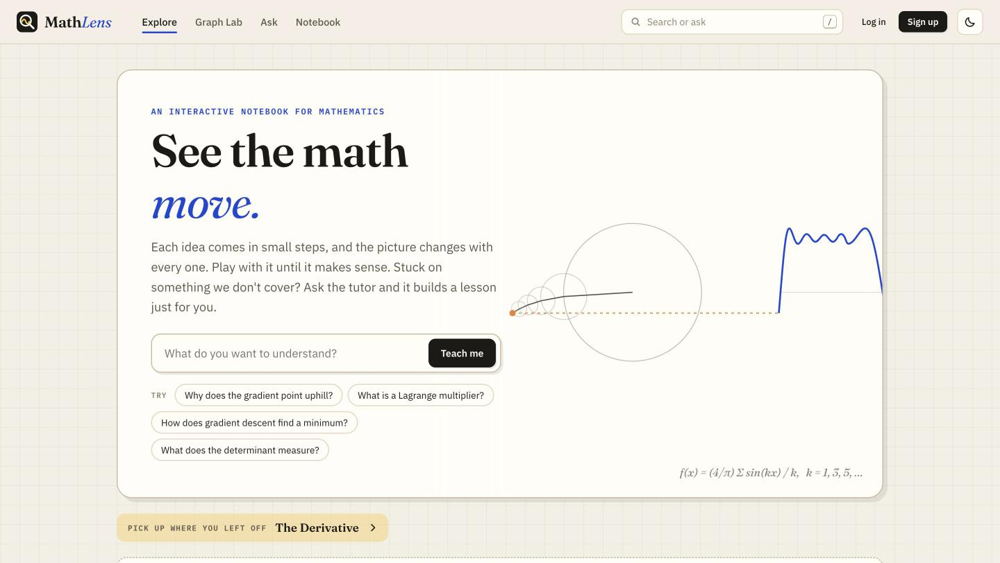
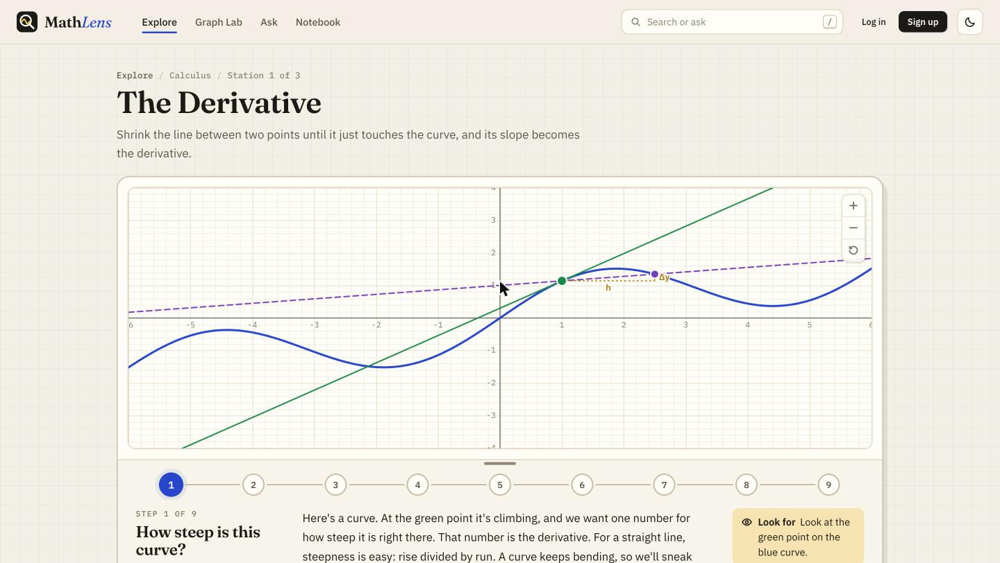
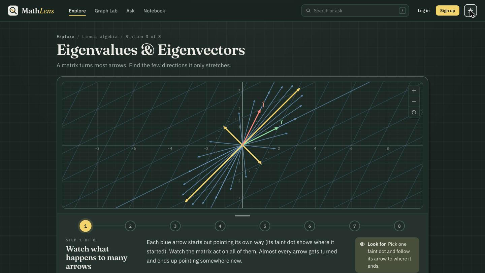
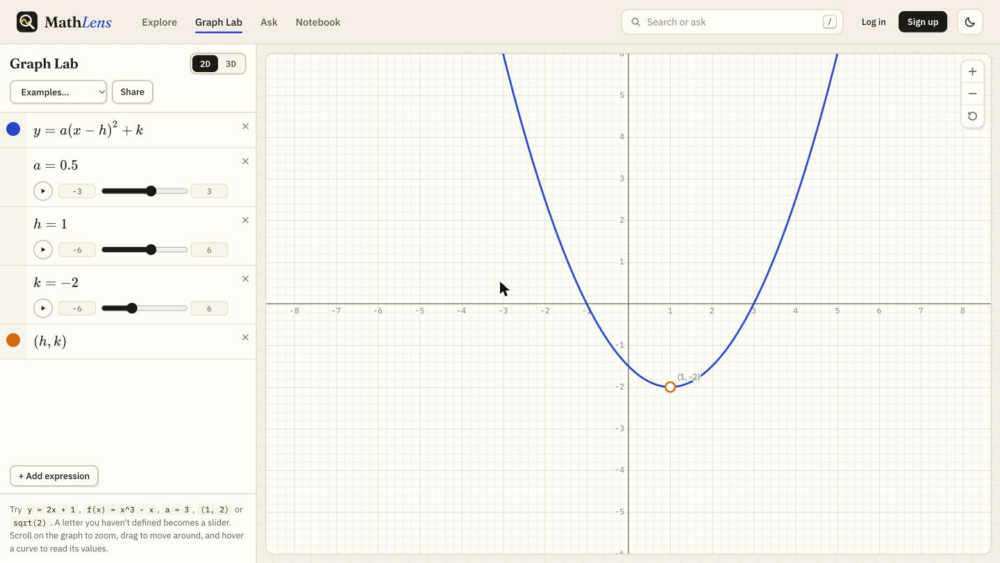
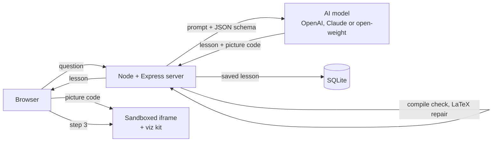

# MathLens

**Learn math by seeing it move.** Ask any math question and an AI tutor writes you a step-by-step lesson with an interactive picture that changes at every step.

**Live at [mathlens.in](https://mathlens.in)**



## What it does

- **AI lessons with pictures.** Type a question, or attach a PDF of a paper you're stuck on. The tutor writes a lesson that starts from a worked example, one idea per step, and builds an interactive visualization (sliders, animations, zoomable graphs, 3D surfaces) that switches scene as you move through the steps.
- **Follow-up chat in every lesson.** Ask about the step you're on, or ask for the picture to change ("use bigger numbers", "add a slider"). The picture stays in view while you talk.
- **Hand-built lessons** on derivatives, Riemann sums, Taylor series, linear transformations, matrix composition, eigenvectors, Fourier series and the central limit theorem.
- **Graph Lab**, a graphing calculator for 2D and 3D. Letters become sliders, points can be dragged, and every graph can be shared as a link.
- **Notebook.** Every lesson you ask for is saved, and reopening one is free.
- **Pay as you go.** No subscription: top up from ₹10 with UPI or card and pay about ₹0.50 a lesson, close to what the AI costs to run.

| A built-in lesson | Dark "chalkboard" theme |
| --- | --- |
|  |  |



## How it works



1. The server asks the model for a lesson as structured JSON: an intro, the steps, and one HTML/JavaScript program that draws the picture.
2. Before anything is saved, every script in the picture is compiled (never run) on the server. Common slips are fixed automatically, others go back to the model once, and a lesson that still doesn't work fails without charging anyone.
3. The browser runs the picture in a sandboxed iframe, so AI-written code can't touch the page. A small kit loaded into the frame gives it zoomable graphs, theme colours, LaTeX equations and a step signal: pressing Next tells the picture which scene to show.
4. Coloured phrases in the text ("the [[orange:tangent line]]") match colours in the picture, and hovering one highlights it.

## Engineering highlights

- **No framework, no build step.** The frontend is plain ES modules; the server is Node with Express and Node's built-in SQLite.
- **Billing at real cost.** Each answer's token usage is priced per model and charged in paise, with a reserve, settle or release flow so failed answers are never charged and one account can't run two answers at once.
- **Abuse limits that hold up.** Free use needs an account, and there are daily limits per person, per network and across the whole site. Answers still being written count toward the limits, so a burst of requests can't get past them.
- **Long answers through a proxy.** Lessons can take two minutes; the server keeps the connection alive through Cloudflare's timeout and reports the real status at the end.
- **Free hosting.** Runs on an Oracle Cloud Always Free server behind a Cloudflare Tunnel (no open ports), with encrypted daily database backups pushed to a private GitHub repo.
- **Payments and accounts.** Razorpay checkout with signature checks and a webhook, email and Google sign-in, password reset by email, and printable receipts.

## Tech stack

Node.js 22+, Express 5, SQLite (`node:sqlite`), vanilla JavaScript, KaTeX, Plotly, pdf.js, the OpenAI and Anthropic APIs, Razorpay, Nodemailer, Oracle Cloud, Cloudflare Tunnel, systemd, age encryption.

## Run it locally

```bash
npm install
cp .env.example .env      # add an AI key (OpenAI, Anthropic, or a local Ollama model)
npm start                 # http://localhost:3000
```

The built-in lessons and Graph Lab work without any key; only the AI tutor needs one. `npm run dev` restarts the server when you edit server files, and frontend files need no build step. Every setting (limits, prices, payments, email) is listed in `.env.example`.

## Documentation

- [docs/DEVELOPMENT.md](docs/DEVELOPMENT.md): how the code is organized, adding a lesson, how AI lessons and chats are built, using open-weight models.
- [docs/OPERATIONS.md](docs/OPERATIONS.md): accounts and free limits, payments, policy pages, deploying, backups and the usage report.

## What's next

- More built-in lessons: gradients and level sets, SVD, complex functions, ODE phase portraits, Markov chains, Bayes' theorem.
- Reading scanned PDFs, which have no text to pull out yet.
- A graduate track: measure theory, functional analysis, differential geometry.

## Author

Built by [Samyak Baid](https://github.com/samyakbaid), a Mathematics and Computer Science student at Ashoka University. Questions and ideas are welcome through [mathlens.in/contact](https://mathlens.in/contact).
